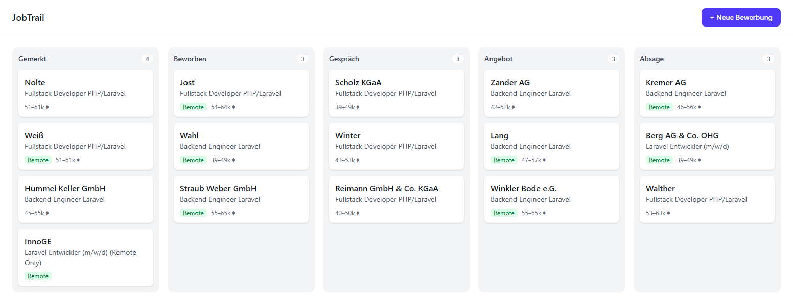

# JobTrail


JobTrail ist ein Bewerbungs-Tracker mit Kanban-Board. Ich habe ihn als Demo-Projekt für meine Bewerbung gebaut, mit Laravel, Livewire und n8n.



## Idee

Bei der Jobsuche verteilen sich Stellenanzeigen schnell auf Browser-Tabs, Lesezeichen und Notizen. Nach zwei Wochen weiß man dann nicht mehr, wo man sich beworben hat und wo man nachhaken sollte.

In JobTrail liegen alle Bewerbungen auf einem Board und werden per Drag & Drop von „Gemerkt“ über „Beworben“ und „Gespräch“ bis zu „Angebot“ oder „Absage“ verschoben. Wenn ich unterwegs eine Anzeige finde, schicke ich den Link an einen Telegram-Bot. Firma, Stelle, Ort und Gehalt werden ausgelesen und die Stelle landet automatisch auf dem Board. Hat sich 14 Tage nach einer Bewerbung nichts getan, erinnert mich der Bot morgens daran, nachzuhaken.


## Starten

Man braucht nur Docker Desktop. Die Befehle der Reihe nach ausführen:

```bash
git clone https://github.com/NikolaosNiko/jobtrail.git
cd jobtrail
cp .env.example .env
docker compose build
docker compose run --rm app composer install
docker compose run --rm app php artisan key:generate
docker compose up -d
docker compose exec app php artisan migrate --seed
```

Danach läuft die App unter http://localhost:8000 und n8n unter http://localhost:5678. Ist der Port schon belegt, kann man ihn in der `.env` über `N8N_PORT` ändern. Die Tests startet man mit `docker compose exec app ./vendor/bin/pest`.

## Telegram-Bot einrichten

Das Board funktioniert auch ohne den Bot. Wer ihn ausprobieren will, legt bei @BotFather einen Bot an und trägt dessen Token und die eigene Chat-ID als `TELEGRAM_BOT_TOKEN` und `TELEGRAM_CHAT_ID` in die `.env` ein. Den Token für die API erzeugt `docker compose exec app php artisan app:api-token`, er kommt als `JOBTRAIL_API_TOKEN` ebenfalls in die `.env`. Danach n8n mit `docker compose up -d n8n` neu starten.

Die beiden Workflows liegen in `n8n/workflows` und werden so importiert:

```bash
docker compose exec n8n n8n import:workflow --input=/workflows/link-speichern.json
docker compose exec n8n n8n import:workflow --input=/workflows/follow-up-erinnerung.json
```

Zum Schluss in n8n beim Node „Groq Chat Model“ einen Groq-Key hinterlegen (kostenlos unter console.groq.com) und beide Workflows aktivieren. Der Bot darf keinen Webhook gesetzt haben, sonst bekommt n8n keine Nachrichten.

## Aufbau

Das Board ist eine Livewire-Komponente (`app/Livewire/Board.php`), weil es dort wirklich Interaktion gibt. Das Formular zum Anlegen und Bearbeiten ist bewusst klassisch mit Controller, Form Request und Blade gebaut. Das ist einfacher zu testen und braucht keinen Server-Aufruf bei jeder Eingabe. Der Status ist ein PHP-Enum (`app/Enums/ApplicationStatus.php`), so liegen Labels, Validierung und Logik an einer Stelle.

n8n greift nie direkt auf die Datenbank zu, sondern nur über eine kleine REST-API mit Sanctum-Token. Es gibt drei Endpunkte: `POST /api/applications` legt eine Stelle an und erkennt doppelte Links, `GET /api/applications/follow-ups` liefert die fälligen Erinnerungen und `POST /api/applications/{id}/reminded` markiert eine Bewerbung als erinnert.

Der Workflow „Link speichern“ fragt jede Minute Telegram nach neuen Nachrichten. Polling statt Webhook habe ich gewählt, weil n8n lokal nicht aus dem Internet erreichbar ist. Aus dem Link werden Tracking-Parameter entfernt, dann wird die Seite geladen. Die meisten Jobbörsen liefern die Daten als JSON-LD für Google mit, die lese ich zuerst aus. Nur wenn das fehlt, liest ein kostenloses Sprachmodell über Groq die Anzeige. Am Ende bekomme ich in Telegram eine Antwort, auch wenn etwas schiefgeht, zum Beispiel bei einer 404-Seite. Der Workflow „Follow-up-Erinnerung“ läuft jeden Morgen um 8 Uhr und schickt alle fälligen Bewerbungen in einer Nachricht.

## Arbeit mit KI

Den Code hat Claude Code geschrieben, ich habe vorgegeben, was gebaut wird und wie. Meine Code-Regeln stehen in `CLAUDE.md`, damit der Agent sie bei jeder Änderung einhält, zum Beispiel Tabs, Alias-Felder mit Gettern und Settern, DocBlocks und keine Arrow-Functions. Jede Änderung habe ich mir erklären lassen und geprüft. Im Workflow nutze ich außerdem das Modell `qwen/qwen3.8-27b` über Groq.

Die Schritte im Überblick:

**Grundgerüst (22.11.):** Laravel, Livewire, Pest, Docker und GitHub Actions eingerichtet, dazu das Board. Alles läuft in Docker, damit das Projekt bei jedem gleich startet und man lokal weder PHP noch MySQL installieren muss.

**Formular (22.11.):** Anlegen, Bearbeiten und Löschen mit Validierung. Ein Test hat gezeigt, dass „Gehalt bis“ ohne „Gehalt von“ abgelehnt wurde, das wurde korrigiert. Beim Review ist mir aufgefallen, dass das Formular bei „Beworben“ kein Datum gesetzt hat und dadurch nie eine Erinnerung kam. Board und Formular nutzen jetzt dieselbe Methode im Model.

**Code-Regeln (23.11.):** Die Regeln habe ich vorgegeben und den Code danach umbauen lassen. Dabei fiel auf, dass `?: null` ein Gehalt von 0 gelöscht hätte. Beim Review habe ich noch einen fehlenden Getter ergänzen lassen.

**REST-API (23.11.):** Den Ablauf von Token über Sanctum bis zur Resource habe ich nachvollzogen. Den Code, den `install:api` erzeugt hat, habe ich an meine Regeln anpassen lassen.

**Link speichern (23.11.):** Mit echten Links über Telegram getestet. Ich habe mich für JSON-LD vor KI und für das kostenlose Groq statt einer bezahlten API entschieden. Probleme gab es mit `new URL()`, das in n8n nicht läuft und dadurch ein Duplikat erzeugt hat, und mit 404-Seiten, die als „nicht erreichbar“ gemeldet wurden. Beides ist behoben.

**Follow-up-Erinnerung (23.11.):** Die Erinnerung habe ich in Telegram bekommen und geprüft. Ich wollte eine Sammelnachricht statt einer Nachricht pro Bewerbung.

**Review (24. und 25.11.):** Ich bin den ganzen Code Teil für Teil durchgegangen. Gefunden wurden das fehlende Datum im Formular, eine falsche Gehaltsanzeige auf dem Board und im Bot, eine zu kurze Datenbankspalte für lange Links und eine Startanleitung, die auf einem frischen Rechner nicht funktioniert hat. Übrig gebliebene Laravel-Vorlagen habe ich entfernt.

## Tests

Es gibt 32 Pest-Tests für Board, Formular, API, den Token-Befehl und das Status-Enum. GitHub Actions führt sie bei jedem Push aus. Die n8n-Workflows habe ich von Hand mit echten Anzeigen und Fehlerfällen getestet.

## Grenzen

Die App hat keinen Login, sie ist für eine Person gedacht und läuft lokal. Drag & Drop geht nur mit der Maus, nicht auf dem Handy. Seiten, die ihren Inhalt erst per JavaScript laden oder automatische Abrufe blockieren, kann der Bot nicht lesen, er sagt dann Bescheid. Bei Anzeigen ohne JSON-LD kann sich das Sprachmodell irren, es soll im Zweifel aber lieber nichts eintragen als raten. Doppelte Links werden nur erkannt, wenn sie genau gleich sind. Durch das Polling antwortet der Bot mit bis zu einer Minute Verzögerung.
