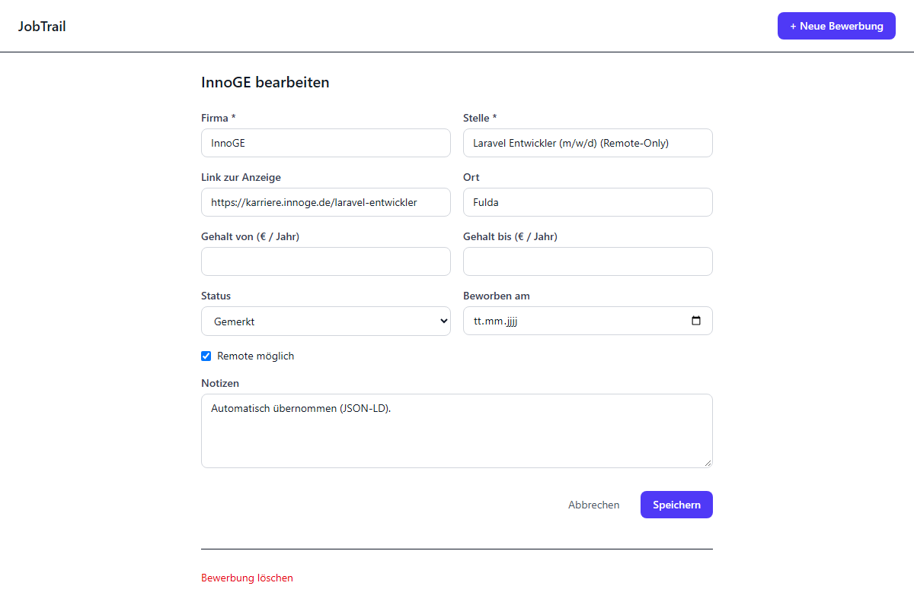
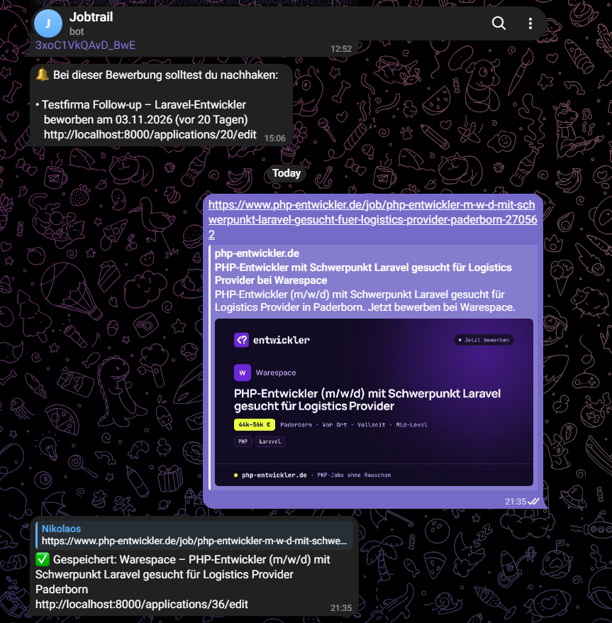

# JobTrail


Ein Bewerbungs-Tracker mit Kanban-Board, gebaut mit Laravel und Livewire und automatisiert mit n8n und Telegram.


| Formular | Telegram |
|---|---|
|  |  |

## Idee

Bei der Jobsuche landen Stellenanzeigen in Browser-Tabs, Lesezeichen und Notizen, und nach zwei Wochen weiß man nicht mehr, wo man nachhaken sollte. JobTrail sammelt alle Bewerbungen auf einem Board:

- Unterwegs reicht es, den Link einer Anzeige an einen Telegram-Bot zu schicken. Firma, Stelle, Ort und Gehalt werden automatisch ausgelesen und als „Gemerkt“ gespeichert.
- Auf dem Board werden Bewerbungen per Drag & Drop durch die Phasen geschoben: Gemerkt → Beworben → Gespräch → Angebot / Absage.
- Kommt 14 Tage nach der Bewerbung keine Antwort, erinnert der Bot morgens ans Nachhaken.

## Features

- [x] Kanban-Board mit Drag & Drop (Livewire + Alpine.js)
- [x] Bewerbungsdatum wird beim Wechsel auf „Beworben“ automatisch gesetzt
- [x] Bewerbungen anlegen, bearbeiten und löschen (Formular + Validierung)
- [x] REST-API mit Laravel Sanctum (für n8n)
- [x] n8n + Telegram: Link schicken → Anzeige wird ausgelesen → Bewerbung wird angelegt
- [x] n8n: tägliche Erinnerung, wenn sich 14 Tage nichts tut

## Tech-Stack

| Bereich | Technologie |
|---|---|
| Backend | Laravel 13, PHP 8.5 |
| Frontend | Livewire 4, Alpine.js, Tailwind CSS 4 |
| Datenbank | MySQL 8.4 (Tests: SQLite in-memory) |
| Tests | Pest 5 |
| Automatisierung | n8n, Telegram Bot API, Groq (LLM, kostenlos) |
| Infrastruktur | Docker Compose, GitHub Actions |

## Starten

Voraussetzung: Docker Desktop.

```bash
git clone https://github.com/NikolaosNiko/jobtrail.git
cd jobtrail
cp .env.example .env
docker compose up -d --build
docker compose exec app composer install
docker compose exec app php artisan key:generate
docker compose exec app php artisan migrate --seed
```

| Dienst | URL |
|---|---|
| App | http://localhost:8000 |
| Vite (Hot Reload) | http://localhost:5173 |
| n8n | http://localhost:5678 (Port über `N8N_PORT` änderbar) |

Tests:

```bash
docker compose exec app ./vendor/bin/pest
```

### Telegram-Bot einrichten (optional)

Das Board funktioniert auch ohne n8n. Für den Bot:

1. Bei [@BotFather](https://t.me/BotFather) einen Bot anlegen und in `.env` `TELEGRAM_BOT_TOKEN` und `TELEGRAM_CHAT_ID` (eigene Chat-ID) eintragen.
2. API-Token erzeugen und als `JOBTRAIL_API_TOKEN` in `.env` eintragen: `docker compose exec app php artisan app:api-token`
3. n8n mit den neuen Werten neu starten: `docker compose up -d n8n`
4. Workflows importieren:
   ```bash
   docker compose exec n8n n8n import:workflow --input=/workflows/link-speichern.json
   docker compose exec n8n n8n import:workflow --input=/workflows/follow-up-erinnerung.json
   ```
5. In n8n beim Node „Groq Chat Model“ eine Groq-Credential auswählen (kostenloser Key unter console.groq.com) und beide Workflows aktivieren.

Der Bot darf keinen Webhook gesetzt haben (z. B. durch einen Telegram-Trigger in einer anderen n8n-Instanz), sonst schlägt `getUpdates` fehl.

## Architektur

```
Telegram ──► n8n ──► REST-API (Sanctum) ──► Laravel ──► MySQL
                                              ▲
Browser ──► Kanban-Board (Livewire) / Formulare (Blade)
```

- `app/Enums/ApplicationStatus.php`: Status mit deutschen Labels
- `app/Models/JobApplication.php`: Model mit Status-Logik (`moveTo()`) und Scopes (`followUpDue()`)
- `app/Livewire/Board.php`: Kanban-Board
- `app/Http/Controllers/JobApplicationController.php` + `JobApplicationRequest.php`: Formulare und Validierung
- `app/Http/Controllers/Api/JobApplicationController.php`: REST-API für n8n
- `n8n/workflows/`: exportierte Workflows

### REST-API

Alle Aufrufe mit `Authorization: Bearer <token>` und `Accept: application/json`. Aus n8n heraus ist die Basis-URL `http://app:8000/api`.

| Methode | Pfad | Zweck |
|---|---|---|
| POST | `/applications` | Stelle als „Gemerkt“ anlegen (`company`, `position`, `url` Pflicht). Bekannter Link → 200 mit bestehender Bewerbung, neu → 201 |
| GET | `/applications/follow-ups` | Bewerbungen seit 14 Tagen auf „Beworben“, noch nicht erinnert |
| POST | `/applications/{id}/reminded` | Bewerbung als erinnert markieren |

### n8n-Workflows

- **Link speichern** (`link-speichern.json`): Jede Minute neue Telegram-Nachrichten per `getUpdates` holen (nur die eigene Chat-ID). Tracking-Parameter wie `utm_*` und `gclid` aus dem Link entfernen, Seite laden, Daten aus JSON-LD (`JobPosting`) lesen, nur wenn das fehlt das Groq-LLM fragen. Danach `POST /applications` und eine Antwort an Telegram, auch bei Fehlern (404, blockiert, Übersichtsseite …).
- **Follow-up-Erinnerung** (`follow-up-erinnerung.json`): Täglich um 8 Uhr `GET /applications/follow-ups`, eine gesammelte Telegram-Nachricht senden, danach jede Bewerbung als erinnert markieren. Ist nichts fällig, wird keine Nachricht gesendet. Über „Manuell testen“ lässt er sich von Hand starten.

### Entscheidungen

- **Livewire nur, wo es interaktiv sein muss** (Board mit Drag & Drop). Formulare sind klassische Controller mit Blade: einfacher, ohne JavaScript testbar, kein Server-Roundtrip pro Tastendruck.
- **Ein Form Request für Anlegen und Bearbeiten**, weil die Regeln identisch sind.
- **Status als PHP-Enum** statt freiem String: Labels, Validierung (`Rule::enum`) und Logik (`isClosed()`) an einer Stelle.
- **n8n spricht nur über die REST-API** mit Laravel, nie direkt mit der Datenbank. Die Validierung liegt so an einer Stelle.
- **JSON-LD vor LLM:** Die meisten Jobbörsen liefern strukturierte Daten mit. Das ist kostenlos und deterministisch, die KI kommt nur zum Einsatz, wenn es nicht anders geht.
- **Telegram-Polling statt Webhook:** Lokal ist n8n aus dem Internet nicht erreichbar, so braucht es keinen Tunnel.
- **Duplikat-Prüfung über den Link:** Wird dieselbe Anzeige zweimal geschickt, gibt die API die bestehende Bewerbung zurück.

## KI-gestützte Entwicklung

### Tools

- **Claude Code** (Coding-Agent) für Code, Tests, Docker-Setup und n8n-Workflows
- **Groq** (`qwen/qwen3.8-27b`) im n8n-Workflow, um Anzeigen ohne strukturierte Daten auszulesen

### Vorgehen

1. Ich beschreibe das Feature und die Rahmenbedingungen (Stack, Architektur, was getestet werden soll).
2. Der Agent schreibt Code und Tests und führt die Tests aus.
3. Ich lese jeden Diff, stelle Rückfragen und lasse ändern, bis ich den Code erklären kann.
4. Meine Code-Konventionen stehen in [`CLAUDE.md`](CLAUDE.md), damit der Agent sie bei jeder Änderung einhält (Tabs, Alias-Felder mit Gettern/Settern, DocBlocks, keine Arrow-Functions …).

### Protokoll

| Datum | Schritt | Was die KI gemacht hat | Was schiefging / korrigiert wurde | Meine Prüfung |
|---|---|---|---|---|
| 22.11.2026 | Grundgerüst | Laravel 13, Livewire 4, Pest 5, Docker Compose (App, Vite, MySQL, n8n), GitHub Actions, Kanban-Board mit Drag & Drop | Lokales PHP (8.2) zu alt → Entscheidung für Docker mit PHP 8.5. Port 5678 war belegt → n8n-Port per `.env` konfigurierbar. Die mitgelieferte `CLAUDE.md` wollte PHP per Internet-Skript installieren → bewusst nicht ausgeführt. || Board im Browser geprüft. Entscheidung für Docker statt lokalem PHP mitgetragen, damit das Projekt bei jedem gleich läuft. |
| 22.11.2026 | Formular | Resource-Controller, Form Request, Blade-Komponenten `x-form.input` / `x-form.select`, Feature-Tests | `gte:salary_min` ohne Bedingung → „Gehalt bis“ ohne „Gehalt von“ wurde abgelehnt. Ein Grenzfall-Test hat das aufgedeckt, Fix mit `Rule::when()`. Fehlermeldungen kamen auf Englisch → eigene deutsche Texte. || Im Review gefunden: Status „Beworben“ im Formular setzte kein Datum, dadurch gab es nie eine Erinnerung. Fix über die gemeinsame Model-Methode `fillMissingAppliedAt()`, plus Tests. |
| 23.11.2026 | Code-Konventionen | Eigene Stilregeln in `CLAUDE.md` festgehalten und den bestehenden Code danach umgebaut | Beim Umbau fiel auf, dass `?: null` ein Gehalt von 0 zu null gemacht hätte → `filled()` verwendet. || Regeln selbst vorgegeben (Tabs, Aliase, Getter/Setter, DocBlocks, keine Arrow-Functions …) und den Code dagegen geprüft. Fehlender `getCreatedAt()` ergänzt. |
| 23.11.2026 | REST-API | Sanctum, drei Endpunkte, Feld `reminded_at`, Befehl `app:api-token`, Tests, End-to-End-Test aus dem n8n-Container | `install:api` hat Code erzeugt, der gegen die Konventionen verstößt → angepasst. || Ablauf Token → Sanctum → Controller → Resource nachvollzogen. Duplikat-Prüfung über den exakten Link als bekannte Grenze akzeptiert. |
| 23.11.2026 | Workflow „Link speichern“ | Telegram-Polling mit gespeichertem Offset, JSON-LD zuerst, Groq als Fallback, Antwort in Telegram | Bearbeiten-Link zeigte auf `http://app:8000` (interner Docker-Host) → nutzt jetzt `APP_URL`. `new URL()` lief in n8ns Code-Sandbox nicht → im Test entstand ein Duplikat, durch eigene String-Logik ersetzt. 404-Seiten wurden als „nicht erreichbar“ gemeldet → Statuscode wird jetzt ausgewertet. || Mit echten Links über Telegram getestet: gespeichert, Duplikat, 404, Übersichtsseite. Entschieden: kostenloses Groq statt bezahlter API, JSON-LD vor KI. Im Review korrigiert: Gehaltsanzeige „45–45k €“. |
| 23.11.2026 | Workflow „Follow-up-Erinnerung“ | Fällige Bewerbungen holen, Sammelnachricht senden, als erinnert markieren. Mit einer Testbewerbung geprüft. | `n8n execute` braucht einen manuellen Start-Node → „Manuell testen“ ergänzt, praktisch auch für Demos. || Erinnerung in Telegram erhalten und geprüft. Entschieden: eine Sammelnachricht statt einer pro Bewerbung. |
| 24.11.2026 | Code-Review | Code Teil für Teil erklärt (Model, Board, Formular, API, n8n) und meine Änderungswünsche umgesetzt | Drei Fehler gefunden: Formular setzte bei „Beworben“ kein Datum, Board und Telegram zeigten bei fehlendem Maximalgehalt „45–0k €“ bzw. „45–45k €“ | Gesamten Code Teil für Teil durchgegangen, drei Fehler gefunden und beheben lassen, drei Tests ergänzt. |

## Qualitätssicherung

- **32 Pest-Tests** (Feature + Unit): Board, Formular inkl. Grenzfälle der Validierung, API inkl. Authentifizierung und Duplikaten, Token-Befehl, Status-Enum
- **GitHub Actions** führt die Tests bei jedem Push aus
- **Manuelle End-to-End-Tests** der Workflows mit echten Stellenanzeigen und Fehlerfällen (404, nicht erreichbar, Übersichtsseite, doppelter Link)
- **Code-Review** jedes Diffs durch mich, Konventionen in `CLAUDE.md`

## Bekannte Grenzen

- Kein Login: Die App ist für eine Person gedacht und läuft lokal.
- Drag & Drop funktioniert nur mit der Maus (HTML5 Drag & Drop), nicht auf Touch-Geräten.
- Seiten, die ihren Inhalt erst per JavaScript laden, oder die automatische Abrufe blockieren, kann der Bot nicht auslesen. Er meldet das und man legt die Bewerbung im Formular an.
- Das LLM kann sich bei Anzeigen ohne JSON-LD irren. Es ist angewiesen, im Zweifel nichts einzutragen statt zu raten.
- Die Duplikat-Prüfung vergleicht den Link exakt: `…/job/123` und `…/job/123/` gelten als verschiedene Anzeigen.
- Durch das Polling antwortet der Bot mit bis zu einer Minute Verzögerung.
- Laravel-Standardmeldungen sind nur für die Formularregeln übersetzt, nicht global.
